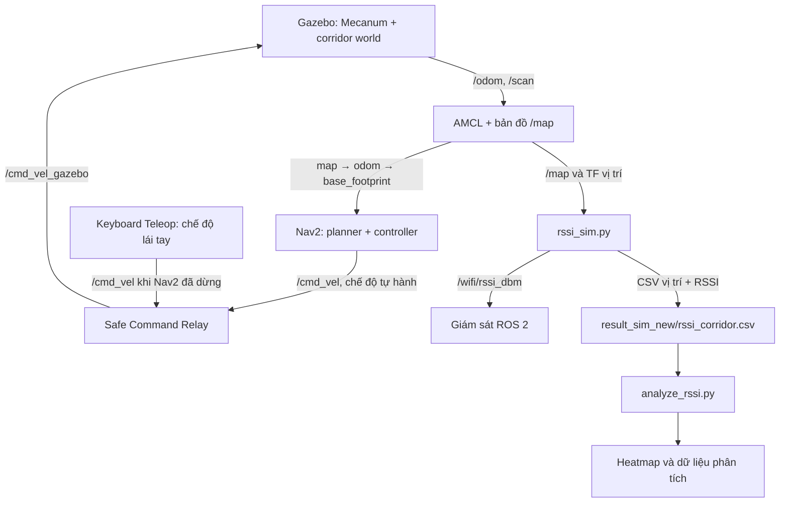
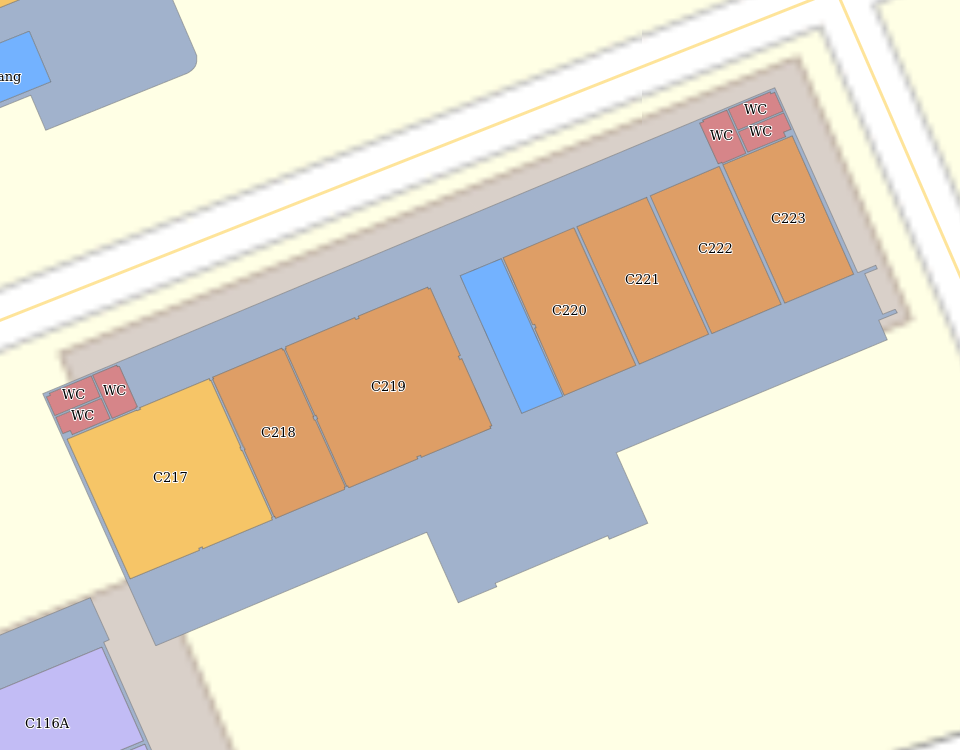
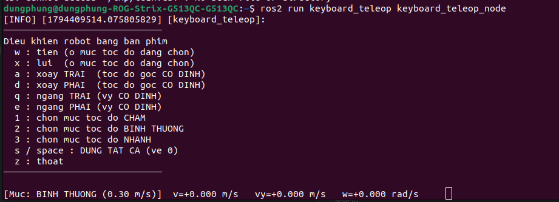
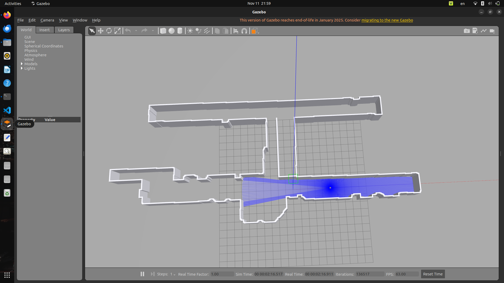
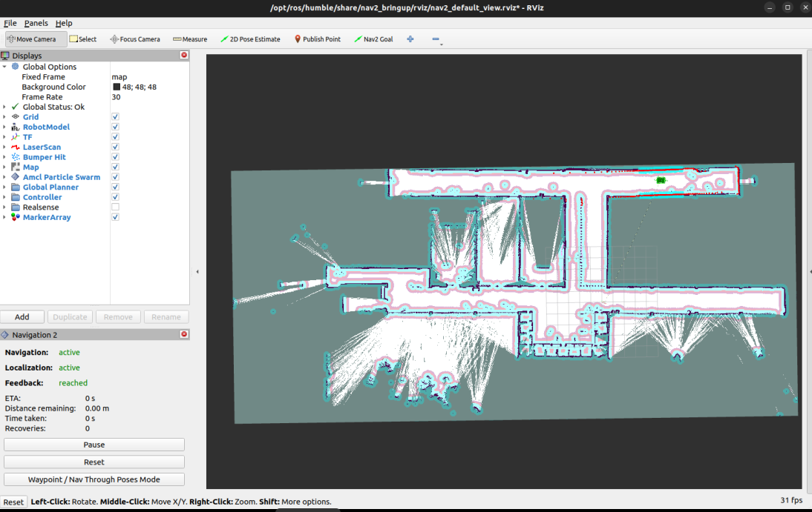

# Khảo sát chất lượng Wi-Fi khu C bằng robot mecanum (PBL3 – Mạng máy tính)

<!-- LTMANG_WORKFLOW_BEGIN -->
## Quy trình vận hành: Gazebo → (Nav2 hoặc Keyboard Teleop) → RSSI → Analysis

Dự án mô phỏng robot **Mecanum** khảo sát cường độ tín hiệu Wi-Fi trong hành lang bằng **ROS 2 Humble**, **Gazebo Classic**, **Nav2**, mô hình RSSI và công cụ phân tích dữ liệu. Robot có thể tự hành bằng Nav2 hoặc lái tay bằng bàn phím; `rssi_sim.py` lấy vị trí robot từ TF, ước lượng RSSI theo vị trí và lưu CSV; `analyze_rssi.py` xử lý CSV và tạo kết quả trực quan hóa.

> **Phân biệt:** Dữ liệu từ `rssi_sim.py` là **RSSI mô phỏng**, không phải phép đo Wi-Fi bằng phần cứng. Các lệnh dưới đây chạy trên **PC Ubuntu** với `ROS_DOMAIN_ID=31`, `ROS_LOCALHOST_ONLY=1`, độc lập với Mini PC của robot thật.

### 1. Các thành phần chính

| Đường dẫn | Vai trò |
|---|---|
| `simulation/ros2_ws/src/mecanum_robot_viz/` | URDF, mesh, cấu hình hiển thị robot trong Gazebo/RViz2 |
| `simulation/ros2_ws/src/mecanum_visual_animator/` | Plugin hình ảnh bánh Mecanum và `/joint_states` |
| `simulation/ros2_ws/src/keyboard_teleop/` | Package ROS 2 điều khiển Mecanum bằng bàn phím |
| `simulation/launch/mecanum_gazebo_corridor_repo.launch.py` | Khởi động world hành lang, spawn robot, robot_state_publisher, relay |
| `simulation/maps/my_map_corridor.world` | Môi trường hành lang Gazebo |
| `simulation/maps/my_map.yaml` và ảnh bản đồ | Bản đồ cho AMCL, Nav2 và phân tích RSSI |
| `simulation/config/nav2_params_mecanum_sim.yaml` | Cấu hình AMCL, controller, planner, costmap, footprint, `use_sim_time` |
| `simulation/scripts/` | Lệnh khởi chạy Gazebo, localization, navigation, RViz2 và `run_teleop.sh` |
| `rssi_sim.py` | Mô phỏng RSSI từ tọa độ robot, publish `/wifi/rssi_dbm` và ghi CSV |
| `analyze_rssi.py` | Phân tích CSV và tạo heatmap/đồ thị |
| `result_te1n/` | Kết quả thí nghiệm cũ; không ghi đè |

### 2. Cài đặt và build (chỉ cần khi mới clone hoặc đổi mã nguồn)

Yêu cầu: Ubuntu 22.04, ROS 2 Humble, Gazebo Classic (`gazebo_ros`), Nav2 (`nav2_bringup`), `colcon`, Python 3 và các thư viện Python mà hai script RSSI sử dụng. Các gói ROS cần được cài sẵn trong môi trường.

```bash
# Clone nếu chưa có thư mục LTMANG
# git clone https://github.com/dungphung27/LTMang.git ~/LTMANG

cd ~/LTMANG/simulation/ros2_ws
source /opt/ros/humble/setup.bash
colcon build --symlink-install
```

> Sau khi build, dùng `simulation/scripts/sim_env.sh` trong các Terminal ROS để nạp overlay của **repository này**. Không chạy cùng một lúc với Gazebo, `robot_state_publisher` hoặc Safe Relay của workspace cũ.

### 3. Khởi động Gazebo — Terminal 1

```bash
cd ~/LTMANG
bash simulation/scripts/run_gazebo.sh
```

Launcher sử dụng `simulation/maps/my_map_corridor.world`, mô hình robot Mecanum mới và Safe Command Relay. Mặc định robot được spawn tại `x=5.0`, `y=0.0`, `z=0.25`, `yaw=0` (hệ tọa độ Gazebo).

Trong Terminal kiểm tra riêng:

```bash
source ~/LTMANG/simulation/scripts/sim_env.sh
ros2 topic list | grep -E '^(/clock|/odom|/scan|/joint_states|/cmd_vel_gazebo)$'
ros2 run tf2_ros tf2_echo odom base_footprint
```

### 4. Khởi động Localization (AMCL) — Terminal 2

```bash
cd ~/LTMANG
bash simulation/scripts/run_localization.sh
```

Lệnh dùng map `simulation/maps/my_map.yaml` và tham số `simulation/config/nav2_params_mecanum_sim.yaml` với `use_sim_time:=true`.

Kiểm tra ở Terminal khác:

```bash
source ~/LTMANG/simulation/scripts/sim_env.sh
ros2 lifecycle get /map_server
ros2 lifecycle get /amcl
```

Cả hai cần ở trạng thái `active [3]`. Vị trí AMCL ban đầu `(5.0, 0.0, 0)` chỉ phù hợp nếu hệ tọa độ world và map đã được căn chỉnh; nếu robot hiển thị sai vị trí, dùng **2D Pose Estimate** trong RViz2.

### 5. Chế độ A — Nav2 Navigation (tự hành) — Terminal 3

```bash
cd ~/LTMANG
bash simulation/scripts/run_navigation.sh
```

Kiểm tra:

```bash
source ~/LTMANG/simulation/scripts/sim_env.sh
ros2 lifecycle get /planner_server
ros2 lifecycle get /controller_server
ros2 lifecycle get /bt_navigator
```

Chỉ gửi mục tiêu khi các node cần thiết đều `active [3]`. Đường điều khiển là **Nav2 → `/cmd_vel` → Safe Relay → `/cmd_vel_gazebo` → Gazebo**; không chạy `keyboard_teleop` đồng thời với Nav2. Nếu controller lỗi khi nạp `PreferForward`, cần cài/build plugin DWB tùy chỉnh hoặc dùng cấu hình kiểm thử đã loại bỏ critic này; **không được coi lỗi plugin là lỗi Gazebo**.

### 6. RViz2 và điều hướng — Terminal 4

```bash
cd ~/LTMANG
bash simulation/scripts/run_rviz.sh
```

Trong RViz2: đặt **Fixed Frame = `map`**, bật `/map`, `/scan`, `/robot_description` và các costmap. Xác nhận robot nằm đúng vị trí trên bản đồ, sau đó chọn **Nav2 Goal** để cho robot tự hành qua các vị trí khảo sát.

Kiểm tra chuỗi TF:

```bash
source ~/LTMANG/simulation/scripts/sim_env.sh
ros2 run tf2_ros tf2_echo map base_footprint
```

### 7. Chế độ B — Điều khiển bàn phím (thay cho Nav2)

Chế độ này giúp lái robot khảo sát Wi-Fi theo quỹ đạo thủ công. **Chạy Gazebo (mục 3), AMCL (mục 4), rồi Keyboard Teleop; không khởi động `run_navigation.sh`.** Có thể mở RViz2 (mục 6) để theo dõi bản đồ và LiDAR. AMCL phải cung cấp TF `map → base_footprint` để RSSI Simulator lưu vị trí robot trong hệ tọa độ map.

Sau khi clone mới hoặc thêm package lần đầu, build trong Terminal:

```bash
cd ~/LTMANG/simulation/ros2_ws
source /opt/ros/humble/setup.bash
colcon build --symlink-install --packages-select keyboard_teleop
```

Mở **Terminal có bàn phím trực tiếp** và chạy:

```bash
cd ~/LTMANG
bash simulation/scripts/run_teleop.sh
```

| Phím | Thao tác |
|---|---|
| `w` / `x` | Tiến / lùi (mức tốc độ đang chọn) |
| `a` / `d` | Xoay trái / phải |
| `q` / `e` | Đi ngang trái / phải (Mecanum) |
| `1` / `2` / `3` | Tốc độ chậm / thường / nhanh |
| `s` hoặc `Space` | Dừng toàn bộ chuyển động |
| `z` | Dừng và thoát chương trình |

Mỗi lần nhấn phím sẽ **duy trì lệnh vận tốc** cho đến khi có phím khác thay đổi trạng thái; `s`/`Space` dừng cả ba trục. Khi nhấn lần lượt `w` rồi `a`, robot sẽ vừa tiến vừa quay, vì các thành phần vận tốc được giữ độc lập. Không chạy qua `ros2 launch` do node cần TTY thật. Script kiểm tra để tránh Nav2 và keyboard cùng xuất `/cmd_vel`.

Sau khi lái tay hoặc Nav2 di chuyển, dùng chung bước 8–9 để thu thập RSSI và phân tích CSV.

### 8. Chạy mô phỏng RSSI và thu thập CSV — Terminal 5

Dùng chung cho cả hai chế độ **Nav2 hoặc Keyboard Teleop**. Chỉ chạy khi AMCL đã định vị và có TF `map → base_footprint`. Trong Terminal riêng:

```bash
cd ~/LTMANG
source simulation/scripts/sim_env.sh
mkdir -p result_sim_new

python3 rssi_sim.py --ros-args \
  -p use_sim_time:=true \
  -p ap_x:=-3.0 \
  -p ap_y:=-1.0 \
  -p csv:="$PWD/result_sim_new/rssi_corridor.csv"
```

`(-3.0, -1.0)` là **tọa độ AP ví dụ**, không phải vị trí AP đã đo. Đổi `ap_x`, `ap_y` theo bố trí thí nghiệm trong **hệ tọa độ map**. Giữ Terminal chạy khi robot di chuyển và thu thập mẫu. Một Terminal kiểm tra khác:

```bash
source ~/LTMANG/simulation/scripts/sim_env.sh
ros2 topic echo /wifi/rssi_dbm --once
head -n 5 ~/LTMANG/result_sim_new/rssi_corridor.csv
```

Khi đã thu thập đủ quỹ đạo, dừng `rssi_sim.py` bằng **Ctrl+C**, đảm bảo file CSV đã được ghi hoàn chỉnh. **Không chạy `analyze_rssi.py` khi chưa có CSV hợp lệ.**

### 9. Phân tích dữ liệu sau thu thập — Terminal 6

```bash
cd ~/LTMANG

python3 analyze_rssi.py result_sim_new/rssi_corridor.csv \
  --ap -3.0 -1.0 \
  --map simulation/maps/my_map.yaml \
  --out result_sim_new/analysis
```

`--ap` phải dùng **cùng tọa độ AP** như khi chạy `rssi_sim.py`. Kiểm tra kết quả:

```bash
find ~/LTMANG/result_sim_new/analysis -maxdepth 2 -type f
```

Đầu ra của bước này là các file phân tích/trực quan hóa từ CSV, phục vụ đánh giá phân bố RSSI trong hành lang. Có thể tham khảo tham số của script bằng `python3 analyze_rssi.py --help`.

### 10. Sơ đồ luồng dữ liệu



### 11. Ghi chú quan trọng

- Cần giữ **cùng map** cho AMCL, RSSI Simulator và Analysis; `simulation/maps/` là bản snapshot của mô phỏng mới, khác với dữ liệu thí nghiệm cũ trong `maps/`.
- Robot dùng hai URDF phù hợp cho Gazebo và RViz2. Không khởi chạy thêm `mecanum_rviz_joint_states.py` khi Gazebo đã phát `/joint_states`.
- Footprint trong Nav2 YAML phải bao phủ được phần thân/bánh thật; xác minh hình học trước khi đánh giá va chạm ở hành lang hẹp.
- Safe Relay có thể giới hạn vận tốc thấp hơn Nav2; kiểm tra `/cmd_vel` và `/cmd_vel_gazebo` nếu robot đi chậm hoặc planner bị timeout.
- Kết quả RSSI là **dữ liệu giả lập theo mô hình suy hao**, không chứng minh chất lượng sóng đo thực tế.
- Giữ Gazebo/AMCL chạy trong lúc thu thập RSSI; dùng **một** nguồn lái tại một thời điểm (Nav2 **hoặc** keyboard). Chỉ chạy Analysis sau khi kết thúc thu thập.

<!-- LTMANG_WORKFLOW_END -->

Đề tài dùng một robot di động tự hành để **đo và vẽ bản đồ cường độ Wi-Fi (RSSI)** trong hành lang khu C
(Đại học Bách Khoa Đà Nẵng), từ đó tìm vùng sóng yếu và đánh giá việc đặt Access Point (AP).

> **Lưu ý:** phần đo RSSI trong repo này là **mô phỏng** (Gazebo + `rssi_sim.py`), chưa phải đo Wi-Fi thật.
> Bản đồ hành lang thì được quét từ môi trường thực tế.



---

## 1. Robot mecanum

Robot dùng **bánh mecanum** nên là robot *holonomic*: ngoài đi tiến/lùi và xoay, nó còn **đi ngang (vy)** và đi chéo
mà không cần xoay thân. Điều này rất hợp với hành lang hẹp, vì robot quay đầu và lách dễ hơn robot hai bánh vi sai.

| Thành phần | Mô tả |
|---|---|
| Hệ điều hành / middleware | Ubuntu 22.04, ROS 2 Humble |
| Khung | Khung 30 × 30 cm, bánh mecanum |
| Cảm biến | LiDAR (quét map, định vị, tránh vật cản), IMU |
| Vi điều khiển | Board OpenCR (Arduino): điều khiển bánh, gửi IMU / odometry / LiDAR qua serial |
| Cầu nối | `mecanum_driver_bridge` (node `serial_bridge`): đưa dữ liệu serial lên topic ROS 2 |
| Mô tả robot | `mecanum_description` (URDF) |
| Ước lượng vị trí | `robot_localization` (EKF) trộn odometry và IMU |
| SLAM | `slam_toolbox` |
| Điều hướng | Nav2 (AMCL + planner + controller + costmap) |
| Mô phỏng | Gazebo Classic + RViz |

---

## 2. Quy trình thực hiện

```
 (1) Quét map thực tế khu C  ──►  (2) Có map  ──►  (3) Chạy robot trong mô phỏng  ──►  (4) Đo RSSI  ──►  (5) Heatmap + kết luận
      slam_toolbox                 .pgm/.yaml          Gazebo + Nav2                    rssi_sim          analyze_rssi
```

### Bước 1 – Quét bản đồ thực tế khu C (bắt buộc làm trước)
Phải có bản đồ trước thì mới làm được các bước sau. Chạy robot thật, bật SLAM rồi lái robot đi hết hành lang:

```bash
source /opt/ros/humble/setup.bash && sleep 2 && ros2 launch ~/ros2_ws/slam_toolbox_mecanum.launch.py
ros2 run keyboard_teleop keyboard_teleop_node        # lái robot đi hết khu C
```

Điều khiển bằng bàn phím: `w/x` tiến/lùi, `a/d` xoay, `q/e` đi ngang, `1/2/3` chọn tốc độ (chậm / bình thường / nhanh),
`s` hoặc space để dừng, `z` để thoát.



Lưu map (`.pgm` + `.yaml`) khi quét xong. Map của repo nằm ở `maps/khuc.pgm` và `maps/khuc.yaml`
(độ phân giải 0.05 m/pixel).

### Bước 2 – Chạy robot trong mô phỏng (Gazebo + Nav2)
Có map rồi mới mô phỏng. Từ map, `maps/khuc.world` là world Gazebo (chỉ gồm tường bao quanh) để mô phỏng cho tiện.
Mỗi lệnh chạy trong một terminal riêng:

```bash
# 1. Gazebo + robot mecanum trong hành lang
ros2 launch mecanum_description mecanum_gazebo_corridor.launch.py

# 2. Định vị trên map (map_server + AMCL)
source /opt/ros/humble/setup.bash && sleep 2 && ros2 launch nav2_bringup localization_launch.py \
    use_sim_time:=true map:=/home/dungphung/maps/khuc.yaml \
    params_file:=/home/dungphung/nav2_params_mecanum_sim.yaml

# 3. Điều hướng (planner, controller, costmap)
source /opt/ros/humble/setup.bash && sleep 5 && ros2 launch nav2_bringup navigation_launch.py \
    use_sim_time:=true params_file:=/home/dungphung/nav2_params_mecanum_sim.yaml

# 4. RViz (2D Pose Estimate, Nav2 Goal)
ros2 launch nav2_bringup rviz_launch.py

# 5. Lái robot bằng bàn phím
ros2 run keyboard_teleop keyboard_teleop_node
```

Trong RViz, đặt vị trí ban đầu bằng **2D Pose Estimate**, sau đó lái robot hoặc gửi **Nav2 Goal**.
(Sửa đường dẫn `map:=` và `params_file:=` cho đúng máy của bạn.)

| Gazebo (world hành lang) | RViz + Nav2 (costmap, AMCL) |
|---|---|
|  |  |

### Bước 3 – Đo RSSI mô phỏng
Trong lúc robot chạy, mở thêm một terminal chạy `rssi_sim.py`. Node đọc vị trí robot (TF `map → base_footprint`)
và map, tính RSSI tại vị trí đó rồi ghi ra CSV (`t_s, x, y, rssi_dbm, rssi_mean_dbm`):

```bash
python3 rssi_sim.py --ros-args -p use_sim_time:=true -p ap_x:=-3.0 -p ap_y:=-1.0 -p csv:=/tmp/te1n.csv
```

Mô hình RSSI:

```
RSSI = P0 − 10·n·log10(d) − 5 dB × (số tường chắn, tối đa 4) + shadowing + fast fading
```

| Tham số | Giá trị |
|---|---|
| P0 (tại 1 m) | −40 dBm |
| Hệ số suy hao n | 2 |
| Suy hao mỗi bức tường | 5 dB |
| Shadowing | σ = 4 dB, tương quan 1.5 m |
| Fast fading | σ = 2 dB |
| Vị trí AP | (−3, −1) trên map |
| Ngưỡng chấp nhận | −67 dBm |

Số tường được đếm bằng cách bắn tia từ AP đến robot trên occupancy grid của map. Có thể đổi vị trí AP lúc đang chạy
bằng **Publish Point** trong RViz. Khi xong, bấm Ctrl+C để dừng và ghi file.

### Bước 4 – Phân tích và vẽ heatmap

```bash
python3 analyze_rssi.py /tmp/te1n.csv --ap -3.0 -1.0 --out result_te1n
```

Các bước xử lý trong `analyze_rssi.py`:
1. Chia map thành các ô 0.5 m × 0.5 m.
2. Mỗi ô: loại outlier bằng MAD rồi lấy median.
3. Nội suy IDW ra lưới mịn, chỉ nội suy gần điểm đo (không ngoại suy xa).
4. Đánh giá bằng leave-one-out RMSE (và RMSE so với đáp án đúng của mô phỏng, nếu có).
5. Hồi quy path loss `RSSI = P0 − 10·n·log10(d)` khi biết vị trí AP.
6. Tính tỉ lệ diện tích đạt ngưỡng −67 dBm.

---

## 3. Kết quả

Lần đo `te1n`: robot đi zigzag quanh AP rồi quét dọc hai hành lang. Thu được **6257 mẫu thô**, gom thành **431 ô** (khoảng 108 m²).


*Trái: quỹ đạo robot, màu theo RSSI (tam giác đỏ = AP). Phải: heatmap IDW, đường đỏ nét đứt là ngưỡng −67 dBm,
các chấm trắng là ô chưa có dữ liệu.*

Thống kê theo khoảng cách tới AP (từ `result_te1n/cells.csv`):

| Khoảng cách tới AP | Số ô | RSSI trung bình | Tỉ lệ ô ≥ −67 dBm |
|---|---|---|---|
| 0 – 5 m | 92 | −45.7 dBm | 100% |
| 5 – 10 m | 69 | −63.2 dBm | 74% |
| 10 – 15 m | 153 | −69.0 dBm | 41% |
| ≥ 15 m | 117 | −75.0 dBm | 22% |

- Toàn bộ vùng đã đo: RSSI từ khoảng −91.8 đến −35.8 dBm, **53.6%** số ô đạt ≥ −67 dBm.
- Hành lang chính (cùng dãy với AP): trung bình −59 dBm, 72% ô đạt ngưỡng.
- Hành lang phía trên (cách AP xa và bị tường ngăn): trung bình −75.5 dBm, chỉ 19% ô đạt ngưỡng.

---

## 4. Kết luận

- Sóng mạnh quanh AP (trong 5 m đều đạt ngưỡng) và **yếu dần theo khoảng cách**. Từ 10 m trở ra, chưa tới một nửa số ô đạt −67 dBm.
- Hai đầu hành lang chính và hành lang phía trên là các vùng yếu nhất, vì vừa xa AP vừa bị tường chắn.
- **Một AP đặt ở giữa không đủ** để phủ toàn bộ khu C. Cần thêm AP hoặc dời AP, ví dụ đặt thêm ở hai đầu hành lang chính và ở hành lang phía trên.
- Hạn chế: số liệu RSSI là mô phỏng theo mô hình log-distance có tính tường, nên cần đo Wi-Fi thật bằng robot để kiểm chứng.

---

## 5. Cấu trúc repo

```
LTMANG/
├── rssi_sim.py          # node ROS 2 mô phỏng RSSI
├── analyze_rssi.py      # CSV -> heatmap + đánh giá
├── maps/
│   ├── khuc.pgm         # bản đồ khu C quét từ thực tế
│   ├── khuc.yaml
│   └── khuc.world       # world Gazebo sinh từ map để mô phỏng
├── result_te1n/
│   ├── heatmap.png
│   └── cells.csv
└── img/                 # ảnh minh hoạ
```

## 6. Yêu cầu
Ubuntu 22.04, ROS 2 Humble, Gazebo Classic, Nav2, slam_toolbox, Python 3 (numpy, scipy, matplotlib, PyYAML).
