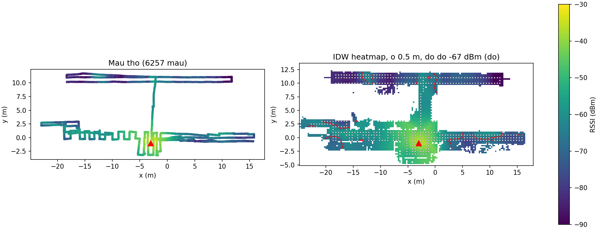

# Khảo sát chất lượng Wi-Fi khu C bằng robot mecanum (PBL3 – Mạng máy tính)

Đề tài dùng một robot di động tự hành để **đo và vẽ bản đồ cường độ Wi-Fi (RSSI)** trong hành lang khu C
(Đại học Bách Khoa Đà Nẵng), từ đó tìm vùng sóng yếu và đánh giá việc đặt Access Point (AP).

> **Lưu ý:** phần đo RSSI trong repo này là **mô phỏng** (Gazebo + `rssi_sim.py`), chưa phải đo Wi-Fi thật.
> Bản đồ hành lang thì được quét từ môi trường thực tế.


---

## 1. Robot mecanum

Robot dùng **bánh mecanum** nên là robot *holonomic*: ngoài đi tiến/lùi và xoay, nó còn **đi ngang (vy)** và đi chéo
mà không cần xoay thân. Điều này rất hợp với hành lang hẹp, vì robot quay đầu và lách dễ hơn robot hai bánh vi sai.

| Thành phần | Mô tả |
|---|---|
| Hệ điều hành / middleware | Ubuntu 22.04, ROS 2 Humble |
| Khung | Khung 30 × 30 cm, bánh mecanum |
| Cảm biến | LiDAR (quét map, định vị, tránh vật cản), IMU |
| Vi điều khiển | Board OpenCR (Arduino): điều khiển bánh, gửi IMU / odometry / LiDAR qua serial |
| Cầu nối | `mecanum_driver_bridge` (node `serial_bridge`): đưa dữ liệu serial lên topic ROS 2 |
| Mô tả robot | `mecanum_description` (URDF) |
| Ước lượng vị trí | `robot_localization` (EKF) trộn odometry và IMU |
| SLAM | `slam_toolbox` |
| Điều hướng | Nav2 (AMCL + planner + controller + costmap) |
| Mô phỏng | Gazebo Classic + RViz |

---

## 2. Quy trình thực hiện

```
 (1) Quét map thực tế khu C  ──►  (2) Có map  ──►  (3) Chạy robot trong mô phỏng  ──►  (4) Đo RSSI  ──►  (5) Heatmap + kết luận
      slam_toolbox                 .pgm/.yaml          Gazebo + Nav2                    rssi_sim          analyze_rssi
```

### Bước 1 – Quét bản đồ thực tế khu C (bắt buộc làm trước)
Phải có bản đồ trước thì mới làm được các bước sau. Chạy robot thật, bật SLAM rồi lái robot đi hết hành lang:

```bash
source /opt/ros/humble/setup.bash && sleep 2 && ros2 launch ~/ros2_ws/slam_toolbox_mecanum.launch.py
ros2 run keyboard_teleop keyboard_teleop_node        # lái robot đi hết khu C
```

Điều khiển bằng bàn phím: `w/x` tiến/lùi, `a/d` xoay, `q/e` đi ngang, `1/2/3` chọn tốc độ (chậm / bình thường / nhanh),
`s` hoặc space để dừng, `z` để thoát.


Lưu map (`.pgm` + `.yaml`) khi quét xong. Map của repo nằm ở `maps/khuc.pgm` và `maps/khuc.yaml`
(độ phân giải 0.05 m/pixel).

### Bước 2 – Chạy robot trong mô phỏng (Gazebo + Nav2)
Có map rồi mới mô phỏng. Từ map, `maps/khuc.world` là world Gazebo (chỉ gồm tường bao quanh) để mô phỏng cho tiện.
Mỗi lệnh chạy trong một terminal riêng:

```bash
# 1. Gazebo + robot mecanum trong hành lang
ros2 launch mecanum_description mecanum_gazebo_corridor.launch.py

# 2. Định vị trên map (map_server + AMCL)
source /opt/ros/humble/setup.bash && sleep 2 && ros2 launch nav2_bringup localization_launch.py \
    use_sim_time:=true map:=/home/dungphung/maps/khuc.yaml \
    params_file:=/home/dungphung/nav2_params_mecanum_sim.yaml

# 3. Điều hướng (planner, controller, costmap)
source /opt/ros/humble/setup.bash && sleep 5 && ros2 launch nav2_bringup navigation_launch.py \
    use_sim_time:=true params_file:=/home/dungphung/nav2_params_mecanum_sim.yaml

# 4. RViz (2D Pose Estimate, Nav2 Goal)
ros2 launch nav2_bringup rviz_launch.py

# 5. Lái robot bằng bàn phím
ros2 run keyboard_teleop keyboard_teleop_node
```

Trong RViz, đặt vị trí ban đầu bằng **2D Pose Estimate**, sau đó lái robot hoặc gửi **Nav2 Goal**.
(Sửa đường dẫn `map:=` và `params_file:=` cho đúng máy của bạn.)

| Gazebo (world hành lang) | RViz + Nav2 (costmap, AMCL) |
|---|---|
|  |  |

### Bước 3 – Đo RSSI mô phỏng
Trong lúc robot chạy, mở thêm một terminal chạy `rssi_sim.py`. Node đọc vị trí robot (TF `map → base_footprint`)
và map, tính RSSI tại vị trí đó rồi ghi ra CSV (`t_s, x, y, rssi_dbm, rssi_mean_dbm`):

```bash
python3 rssi_sim.py --ros-args -p use_sim_time:=true -p ap_x:=-3.0 -p ap_y:=-1.0 -p csv:=/tmp/te1n.csv
```

Mô hình RSSI:

```
RSSI = P0 − 10·n·log10(d) − 5 dB × (số tường chắn, tối đa 4) + shadowing + fast fading
```

| Tham số | Giá trị |
|---|---|
| P0 (tại 1 m) | −40 dBm |
| Hệ số suy hao n | 2 |
| Suy hao mỗi bức tường | 5 dB |
| Shadowing | σ = 4 dB, tương quan 1.5 m |
| Fast fading | σ = 2 dB |
| Vị trí AP | (−3, −1) trên map |
| Ngưỡng chấp nhận | −67 dBm |

Số tường được đếm bằng cách bắn tia từ AP đến robot trên occupancy grid của map. Có thể đổi vị trí AP lúc đang chạy
bằng **Publish Point** trong RViz. Khi xong, bấm Ctrl+C để dừng và ghi file.

### Bước 4 – Phân tích và vẽ heatmap

```bash
python3 analyze_rssi.py /tmp/te1n.csv --ap -3.0 -1.0 --out result_te1n
```

Các bước xử lý trong `analyze_rssi.py`:
1. Chia map thành các ô 0.5 m × 0.5 m.
2. Mỗi ô: loại outlier bằng MAD rồi lấy median.
3. Nội suy IDW ra lưới mịn, chỉ nội suy gần điểm đo (không ngoại suy xa).
4. Đánh giá bằng leave-one-out RMSE (và RMSE so với đáp án đúng của mô phỏng, nếu có).
5. Hồi quy path loss `RSSI = P0 − 10·n·log10(d)` khi biết vị trí AP.
6. Tính tỉ lệ diện tích đạt ngưỡng −67 dBm.

---

## 3. Kết quả

Lần đo `te1n`: robot đi zigzag quanh AP rồi quét dọc hai hành lang. Thu được **6257 mẫu thô**, gom thành **431 ô** (khoảng 108 m²).



*Trái: quỹ đạo robot, màu theo RSSI (tam giác đỏ = AP). Phải: heatmap IDW, đường đỏ nét đứt là ngưỡng −67 dBm,
các chấm trắng là ô chưa có dữ liệu.*

Thống kê theo khoảng cách tới AP (từ `result_te1n/cells.csv`):

| Khoảng cách tới AP | Số ô | RSSI trung bình | Tỉ lệ ô ≥ −67 dBm |
|---|---|---|---|
| 0 – 5 m | 92 | −45.7 dBm | 100% |
| 5 – 10 m | 69 | −63.2 dBm | 74% |
| 10 – 15 m | 153 | −69.0 dBm | 41% |
| ≥ 15 m | 117 | −75.0 dBm | 22% |

- Toàn bộ vùng đã đo: RSSI từ khoảng −91.8 đến −35.8 dBm, **53.6%** số ô đạt ≥ −67 dBm.
- Hành lang chính (cùng dãy với AP): trung bình −59 dBm, 72% ô đạt ngưỡng.
- Hành lang phía trên (cách AP xa và bị tường ngăn): trung bình −75.5 dBm, chỉ 19% ô đạt ngưỡng.

---

## 4. Kết luận

- Sóng mạnh quanh AP (trong 5 m đều đạt ngưỡng) và **yếu dần theo khoảng cách**. Từ 10 m trở ra, chưa tới một nửa số ô đạt −67 dBm.
- Hai đầu hành lang chính và hành lang phía trên là các vùng yếu nhất, vì vừa xa AP vừa bị tường chắn.
- **Một AP đặt ở giữa không đủ** để phủ toàn bộ khu C. Cần thêm AP hoặc dời AP, ví dụ đặt thêm ở hai đầu hành lang chính và ở hành lang phía trên.
- Hạn chế: số liệu RSSI là mô phỏng theo mô hình log-distance có tính tường, nên cần đo Wi-Fi thật bằng robot để kiểm chứng.

---

## 5. Cấu trúc repo

```
LTMANG/
├── rssi_sim.py          # node ROS 2 mô phỏng RSSI
├── analyze_rssi.py      # CSV -> heatmap + đánh giá
├── maps/
│   ├── khuc.pgm         # bản đồ khu C quét từ thực tế
│   ├── khuc.yaml
│   └── khuc.world       # world Gazebo sinh từ map để mô phỏng
├── result_te1n/
│   ├── heatmap.png
│   └── cells.csv
└── img/                 # ảnh minh hoạ
```

## 6. Yêu cầu
Ubuntu 22.04, ROS 2 Humble, Gazebo Classic, Nav2, slam_toolbox, Python 3 (numpy, scipy, matplotlib, PyYAML).

## Mô phỏng robot Mecanum mới (Gazebo Classic + Nav2)

Đã bổ sung snapshot robot Gazebo/RViz2, plugin bánh Mecanum, LiDAR/IMU, world hành lang, bản đồ `my_map`, cấu hình Nav2 và script khởi chạy ở [`simulation/README.md`](simulation/README.md). Giữ nguyên pipeline RSSI và các kết quả `result_te1n/`. Thành phần mô phỏng chạy riêng trên PC (`ROS_DOMAIN_ID=31`); không sửa chương trình Mini PC robot thật.
